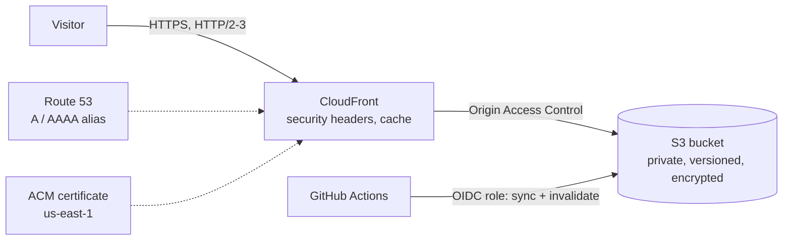

# terraform-aws-static-site

Terraform module for a production static site on AWS: private S3 bucket, CloudFront with Origin
Access Control, HTTPS on your own domain, security headers, HTTP/3, and a least-privilege OIDC
role so GitHub Actions can publish without stored AWS keys.

Maintained by [GonService](https://gonserviceit.com.br/devops) · [Português](#em-português)



## Features

| Area | Details |
| --- | --- |
| Storage | Private bucket, public access blocked, bucket-owner enforced, SSE-S3, versioning, old versions expire after 30 days, HTTPS-only policy |
| CDN | CloudFront with OAC (no public bucket), `Managed-CachingOptimized`, compression, IPv6, HTTP/2 and HTTP/3 |
| Security headers | HSTS (1 year, preload), `X-Content-Type-Options`, `X-Frame-Options`, `Referrer-Policy` |
| Custom domain | Optional: ACM certificate with DNS validation in Route 53, A and AAAA alias records |
| Errors | Custom `404.html`, or `spa_mode = true` to serve `index.html` for client-side routing |
| Deploy | Optional IAM role for GitHub OIDC limited to this bucket and distribution, plus a ready [deploy workflow](.github/workflows/deploy-site.yml) |

## Usage

```hcl
provider "aws" {
  region = "sa-east-1"
}

provider "aws" {
  alias  = "us_east_1" # CloudFront certificates live in us-east-1
  region = "us-east-1"
}

module "site" {
  source = "github.com/GonService/terraform-aws-static-site"

  providers = {
    aws           = aws
    aws.us_east_1 = aws.us_east_1
  }

  name              = "my-site"
  domain_name       = "www.example.com"   # optional
  hosted_zone_id    = "Z0123456789ABC"    # required with domain_name
  github_repository = "my-org/my-site"    # optional: creates the deploy role
}
```

A complete root configuration is in [`examples/complete`](examples/complete).

## Inputs

| Name | Description | Default |
| --- | --- | --- |
| `name` | Short name for resources (3–42 lowercase letters, digits, hyphens) | required |
| `domain_name` | Custom domain; empty serves on the CloudFront domain only | `""` |
| `hosted_zone_id` | Route 53 zone for `domain_name` | `""` |
| `price_class` | `PriceClass_100`, `PriceClass_200` or `PriceClass_All` | `PriceClass_100` |
| `spa_mode` | Serve `index.html` for 403/404 (single-page apps) | `false` |
| `github_repository` | `owner/name` allowed to deploy through OIDC | `""` |
| `github_branch` | Branch allowed to deploy | `main` |
| `create_github_oidc_provider` | Create the GitHub OIDC provider (one per account) | `false` |
| `tags` | Tags for every resource | `{}` |

## Outputs

`bucket_name`, `distribution_id`, `cloudfront_domain`, `url`, `deploy_role_arn`.

## Publishing from GitHub

1. Apply the module with `github_repository` set.
2. In the site repository, add the secret `AWS_ROLE_ARN` (output `deploy_role_arn`) and the
   variables `AWS_REGION`, `SITE_BUCKET` and `CLOUDFRONT_DISTRIBUTION_ID`.
3. Push changes under `site/`: HTML goes up with a 60-second cache, other assets with a one-year
   immutable cache, then CloudFront is invalidated.

## Cost

For a typical low-traffic site the bill is usually a few dollars a month, mostly the Route 53
hosted zone. Check current [CloudFront](https://aws.amazon.com/cloudfront/pricing/) and
[S3](https://aws.amazon.com/s3/pricing/) pricing for your traffic.

## Em português

Módulo Terraform para hospedar um site estático na AWS do jeito certo: bucket S3 privado,
CloudFront com Origin Access Control, HTTPS no seu domínio, cabeçalhos de segurança, HTTP/3 e um
papel IAM via OIDC para o GitHub Actions publicar sem chaves da AWS guardadas no GitHub. Custo
baixo, sem servidor para manter e com deploy automático a cada push.

Quer seu site ou sua aplicação publicados assim? A GonService faz:
[gonserviceit.com.br/devops](https://gonserviceit.com.br/devops) ·
[contato@gonserviceit.com.br](mailto:contato@gonserviceit.com.br)

## License

[MIT](LICENSE)
